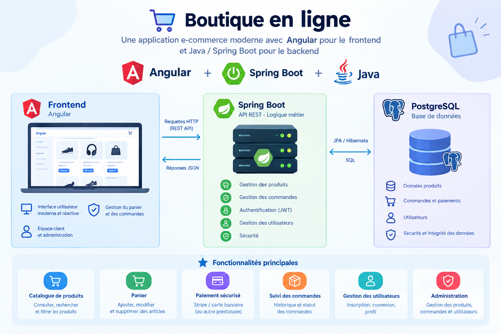

# SpringApp

Boutique en ligne : API REST Spring Boot, base de données PostgreSQL, migration FlyWay, Angular pour le front et le tout
conteneurisé par Docker.

*Image générée par IA*

---

## Sommaire

* [Objectif](#objectif)
* [Fonctionnalités principales](#fonctionnalités-principales)
* [Documentation](#documentation)

## Objectif

SpringApp a été conçu pour :
* simuler un projet proche de conditions réelles (Docker, CI) ;
* mettre en pratique une architecture backend avec Spring Boot ;
* mettre en place une interface utilisateur avec Angular.

## Fonctionnalités principales

* authentification et gestion des utilisateurs ;
* recherche de produits, filtrage de produits ;
* création et gestion des commandes ;

### Fonctionnalités à mettre en place

* système de paiement (Stripe) ;
* système d'envoi d'e-mail ;
* remise du stock à jour quand une commande est annulée ;

## Documentation

Une documentation est disponible [ici](docs/index.md).

## License

[MIT](LICENSE.md)

## Crédit

Le projet a été initialement développé par [Umm-Habibah](https://github.com/habibahdev).

