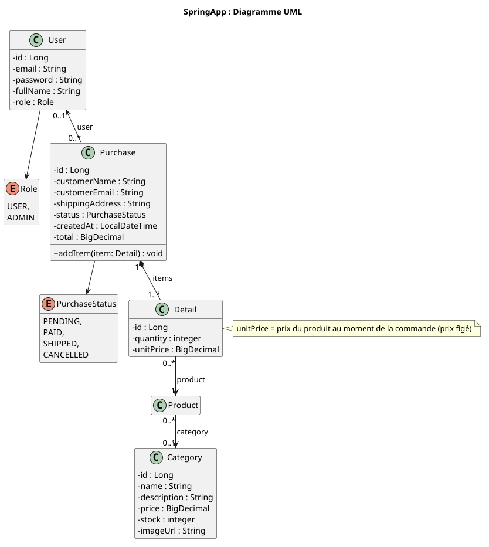
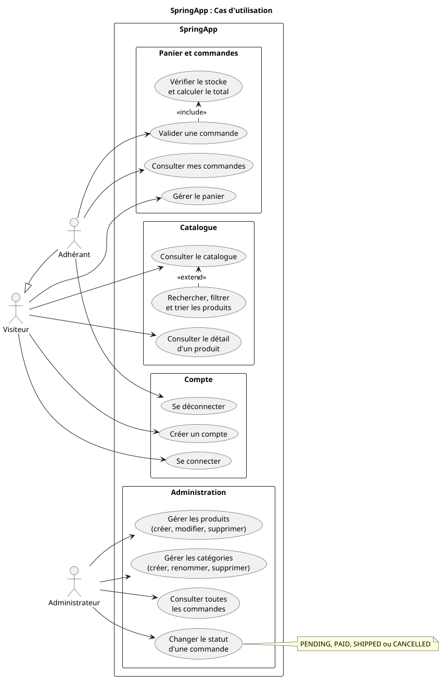

# Documentation

[Retour](../README.md)

---

## Sommaire

* [Prérequis](#prérequis)
* [Installation](#installation)
* [Configuration](#configuration)
* [Lancement](#lancement)
* [Modèle de données](#modèle-de-données)
* [Cas d'utilisation](#cas-dutilisation)
* [API REST](#api-rest)
* [Swagger UI](#swagger-ui)

---

## Prérequis

- [Docker et Docker Compose](https://docs.docker.com/compose/install/)
- [Postman](https://www.postman.com/downloads/) ou curl

## Installation

Cloner le dépôt :

```bash
git clone git@github.com:habibahdev/springapp.git
```

## Configuration

### Fichier `.env`

Positionnez-vous dans le dossier `springapp`.

Créer un fichier `.env` à la racine du dossier

```bash
SPRING_DATASOURCE_URL=jdbc:postgresql://postgres:5432/springapp
SPRING_DATASOURCE_USERNAME=springapp
SPRING_DATASOURCE_PASSWORD=mot-de-passe-à-définir

APP_JWT_SECRET=clé-secréte-à-générer
APP_JWT_EXPIRATION=86400000
```
> Pour générer une clé JWT :
> ```bash
> openssl rand -hex 32
> ```

### Fichier `application.properties`

L'application utilise PostgreSQL pour stocker les données. La configuration de connexion est définie dans les fichiers
de configuration Spring. Le fichier `.env` définit plutôt peut être modifié à condition que les données soient
synchronisés avec le fichier `application.properties` : 

```properties
# general
spring.application.name=springapp
server.port=8080

# database
spring.datasource.url=${SPRING_DATASOURCE_URL}
spring.datasource.username=${SPRING_DATASOURCE_USERNAME}
spring.datasource.password=${SPRING_DATASOURCE_PASSWORD}

# hibernate
spring.jpa.hibernate.ddl-auto=validate

# flyway
spring.flyway.baseline-on-migrate=true
spring.flyway.baseline-version=1

# JWT
app.jwt.secret=${APP_JWT_SECRET}
app.jwt.expiration-ms=${APP_JWT_EXPIRATION}
```

Les migrations de schéma sont gérées par [Flyway](https://github.com/flyway/flyway). Au démarrage, Flyway applique les
migrations disponibles qui n'ont pas encore été exécutées.

Les fichiers de migration se trouvent dans :

```text
backend/src/main/resources/db/migration/
```

Il est recommandé de modifier le schéma de la base de données au moyen de nouvelles migrations plutôt que de modifier
manuellement une base déjà utilisée.

## Lancement
À la racine du projet :

```bash
docker compose up -d
```

## Modèle de données

[](uml/database.puml)

## Cas d'utilisation

[](uml/use_case.puml)

## API REST

Les routes suivantes correspondent aux fonctionnalités principales de l'application.

### Authentification

Préfixe : `/api/auth`

| Méthode | Route | Description | Accès |
|---|---|---|---|
| POST | `/register` | Inscrire un utilisateur | public |
| POST | `/login` | Authentifier un utilisateur et obtenir un jwt | public |

Le jeton obtenu lors de la connexion doit être envoyé dans l'en-tête `Authorization` des requêtes protégées :

```http request
Authorization: Bearer <jwt>
```

### Catégories : `/api/categories`

| Méthode | Route      | Accès  |
|---------|------------|--------|
| GET     | `/`        | public |
| POST    | `/`        | admin |
| PUT     | `/{id}`    | admin |
| DELETE  | `/{id}` | admin |

### Produits : `/api/products`

| Méthode | Route      | Accès  |
|---------|------------|--------|
| GET     | `/`        | public |
| GET     | `/{id}`        | public |
| POST    | `/`        | admin |
| PUT     | `/{id}`    | admin |
| DELETE  | `/{id}` | admin |

Paramètres de `GET /api/products` : 

| Paramètre | Défaut | Description |
| ---|---|---|
| `q` | - | Nom contenant le texte (insensible à la casse) |
| `categoryId` | - | Produits de cette catégorie ; se combine avec `q` |
| `page` | `0` | index de page |
| `size` | `12` | borné entre 1 et 50 |
| `sort` | `name` | `name`, `price` ou `id` ; toutes autre valeur est remplacée par `name` |

### Commandes : `/api/purchases`

| Méthode | Route      | Accès  | Paramètres |
|---------|------------|--------|---|
| POST     | `/`        | connecté | - |
| GET     | `/me`        | connecté | - |
| GET    | `/`        | admin | - |
| GET     | `/{id}`    | admin | - |
| PATCH  | `/{id}/status` | admin | `?status=PENDING\|PAID\|SHIPPED\|CANCELLED` |

- l'utilisateur d'une commande est **toujours celui du token** : un client ne peut pas commander au nom de quelqu'un d'autre

## Swagger UI

La documentation Swagger UI est disponible ici :

```bash
http://localhost:8080/swagger-ui/index.html
```