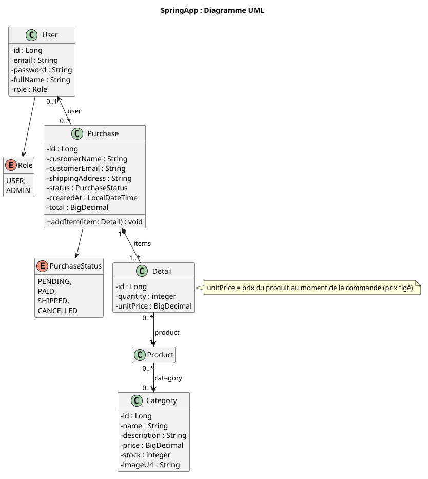
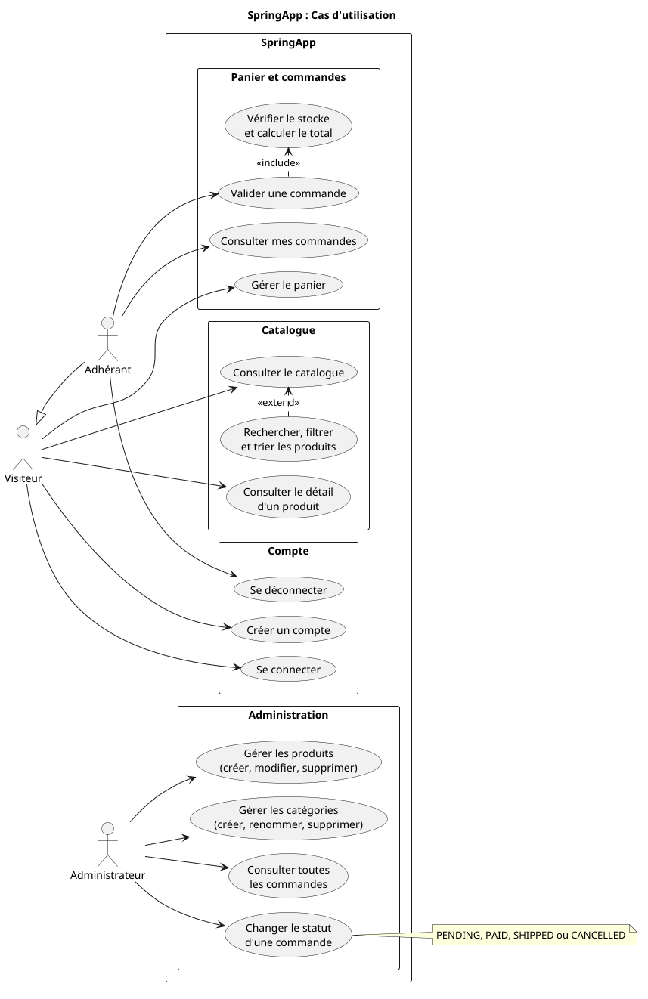

# Documentation

[Retour](../README.md)

---

## Sommaire

* [Prérequis](#prérequis)
* [Installation](#installation)
* [Configuration](#configuration)
* [Lancement](#lancement)
* [Modèle de données](#modèle-de-données)
* [Cas d'utilisation](#cas-dutilisation)
* [API REST](#api-rest)
* [Paiement avec Stripe](#paiement-avec-stripe)
* [Swagger UI](#swagger-ui)
* [Scénarios de test](#tests)

---

## Prérequis

- [Docker et Docker Compose](https://docs.docker.com/compose/install/)
- [Postman](https://www.postman.com/downloads/) ou curl
- Un compte [Stripe](https://dashboard.stripe.com/login) en mode test

## Installation

Cloner le dépôt :

```bash
git clone git@github.com:habibahdev/springapp.git
```

Positionnez-vous à la racine du projet :

```bash
cd springapp
```

## Configuration

### Fichier `.env`

Créer un fichier `.env` à la racine du projet.

```env
SPRING_DATASOURCE_URL=jdbc:postgresql://postgres:5432/springapp
SPRING_DATASOURCE_USERNAME=springapp
SPRING_DATASOURCE_PASSWORD=mot-de-passe-à-définir

APP_JWT_SECRET=clé-secréte-à-générer
APP_JWT_EXPIRATION=86400000

STRIPE_SECRET_KEY=sk_test_votre_clé
STRIPE_WEBHOOK_SECRET=whsec_votre_clé
```

> Pour générer une clé JWT :
> ```bash
> openssl rand -hex 32
> ```

Les clés Stripe sont disponibles dans le tableau de bord Stripe de votre compte.

### Fichier `application.properties`

L'application utilise PostgreSQL pour stocker les données. La configuration est définie dans les fichiers
Spring et les variables d'environnement.

```properties
# general
spring.application.name=springapp
server.port=8080

# database
spring.datasource.url=${SPRING_DATASOURCE_URL}
spring.datasource.username=${SPRING_DATASOURCE_USERNAME}
spring.datasource.password=${SPRING_DATASOURCE_PASSWORD}

# hibernate
spring.jpa.hibernate.ddl-auto=validate

# flyway
spring.flyway.baseline-on-migrate=true
spring.flyway.baseline-version=1

# JWT
app.jwt.secret=${APP_JWT_SECRET}
app.jwt.expiration-ms=${APP_JWT_EXPIRATION}

# stripe
stripe.secret-key=${STRIPE_SECRET_KEY}
stripe.webhook-secret=${STRIPE_WEBHOOK_SECRET}
stripe.success-url=http://localhost:4200/payment/success?session_id={CHECKOUT_SESSION_ID}
stripe.cancel-url=http://localhost:4200/payment/cancel
```

### Gestion des migrations avec Flyway

Les migrations de schéma sont gérées par [Flyway](https://github.com/flyway/flyway).

Au démarrage de l'application, Flyway applique automatiquement les
migrations disponibles qui n'ont pas encore été exécutées.

Les fichiers de migration se trouvent dans :

```text
backend/src/main/resources/db/migration/
```

Chaque migration suit une convention de nommage, par exemple : 

```text
V1__initial_schema.sql
V2__add_column.sql
```

Les numéros doivent être uniques et respecter l'ordre chronologique des migrations.

Il est recommandé de modifier le schéma de la base de données au moyen de nouvelles migrations
plutôt que de modifier manuellement une base déjà utilisée.

Hibernate utilise `ddl-auto=validate` : il vérifie la correspondance entre les entités Java et le
schéma PostgreSQL sans modifier automatiquement la structure de la base.

## Lancement

À la racine du projet :

```bash
docker compose up -d --build
```

Pour consulter les logs du backend et du frontend :

```bash
docker compose logs -f backend
docker compose logs -f frontend
```

L'application est accessible aux adresses suivantes :

| Service | Adresse |
|---|---|
| Frontend | http://localhost:4200 |
| Backend | http://localhost:8080 |
| Swagger UI | http://localhost:8080/swagger-ui/index.html |

## Modèle de données

[](uml/database.puml)

## Cas d'utilisation

[](uml/use_case.puml)

## API REST

Les routes suivantes correspondent aux fonctionnalités principales de l'application.

### Authentification

Préfixe : `/api/auth`

| Méthode | Route | Description | Accès |
|---|---|---|---|
| POST | `/register` | Inscrire un utilisateur | public |
| POST | `/login` | Authentifier un utilisateur et obtenir un jwt | public |

Le jeton obtenu lors de la connexion doit être envoyé dans l'en-tête `Authorization` des requêtes protégées :

```http request
Authorization: Bearer <jwt>
```

### Catégories : `/api/categories`

| Méthode | Route      | Accès  |
|---------|------------|--------|
| GET     | `/`        | public |
| POST    | `/`        | admin |
| PUT     | `/{id}`    | admin |
| DELETE  | `/{id}` | admin |

### Produits : `/api/products`

| Méthode | Route      | Accès  |
|---------|------------|--------|
| GET     | `/`        | public |
| GET     | `/{id}`        | public |
| POST    | `/`        | admin |
| PUT     | `/{id}`    | admin |
| DELETE  | `/{id}` | admin |

Paramètres de `GET /api/products` : 

| Paramètre | Défaut | Description |
| ---|---|---|
| `q` | - | Nom contenant le texte (insensible à la casse) |
| `categoryId` | - | Produits de cette catégorie ; se combine avec `q` |
| `page` | `0` | index de page |
| `size` | `12` | borné entre 1 et 50 |
| `sort` | `name` | `name`, `price` ou `id` ; toutes autre valeur est remplacée par `name` |

### Commandes : `/api/purchases`

| Méthode | Route      | Accès  | Paramètres |
|---------|------------|--------|---|
| GET     | `/me`        | connecté | - |
| GET     | `/me/{id}`        | connecté | - |
| GET    | `/`        | admin | - |
| GET     | `/{id}`    | admin | - |
| PATCH  | `/{id}/status` | admin | `?status=PENDING\|PAID\|SHIPPED\|CANCELLED` |

- l'utilisateur d'une commande est **toujours celui du token** : un client ne peut pas commander au nom de quelqu'un d'autre

### Paiement : `api/payments`

| Méthode | Route      | Accès  | Paramètres |
|---------|------------|--------|---|
| POST     | `/checkout`        | connecté | - |
| POST     | `/webhook`        | public | - |

Le webhook est accessible sans authentification JWT, car les requêtes sont envoyées directement par stripe.
Chaque événement doit néanmoins être vérifié à l'aide de la signature stripe.

## Paiement avec Stripe

L'application utilise Stripe Checkout pour gérer les paiements en ligne.

Le processus de paiement se déroule en plusieurs étapes :
1. L'utilisateur ajoute des produits à son panier
2. Il renseigne son adresse de livraison
3. Le frontend transmet les produits et leurs quantités au backend
4. Le backend vérifie les stocks disponibles et crée une commande avec le status `PENDING`
5. Le backend crée une session Stripe checkout et renvoie son url au frontend
6. L'utilisateur est redirigé vers la page de paiement stripe
7. Stripe transmet un événement au backend via le webhook
8. Le backend confirme le paiement et met à jour le statut de la commande

Les événements stripe traités comprennent notamment :
- `checkout.session.completed`
- `checkout.session.async_payement_succeeded`
- `checkout.session.async_payement_failed`
- `checkout.session.expired`


## Swagger UI

La documentation Swagger UI est disponible ici :

```bash
http://localhost:8080/swagger-ui/index.html
```

## Scénarios de test

Les tests curl sont disponibles [ici](tests.md).